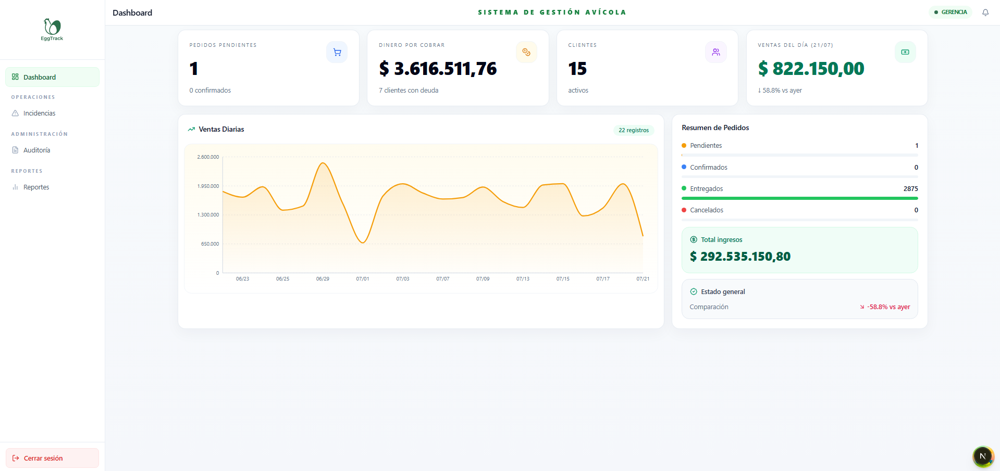
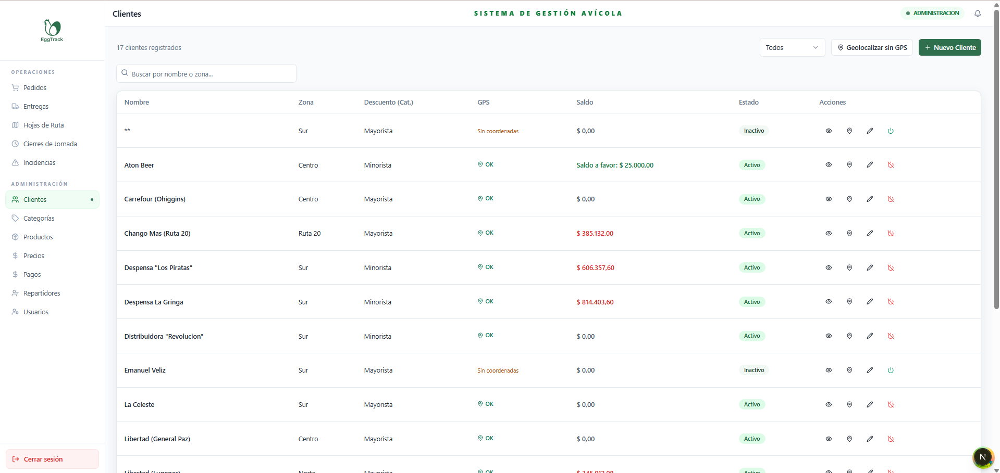
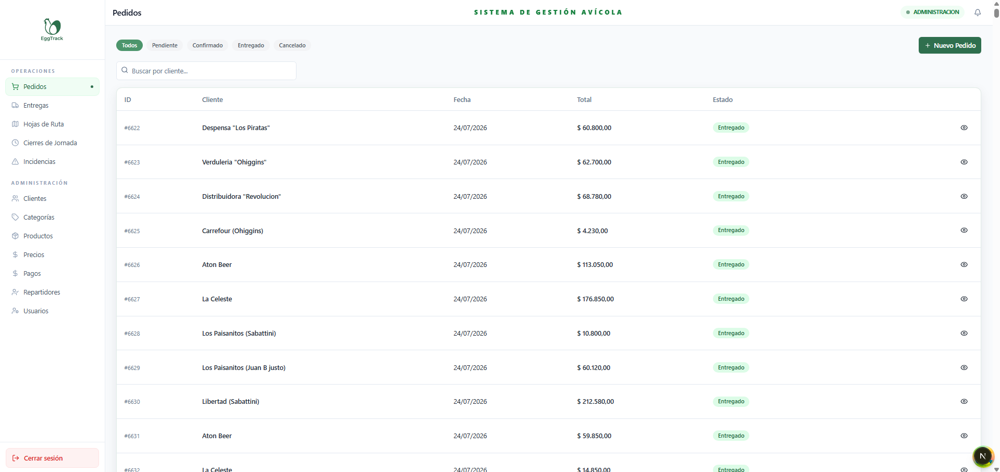
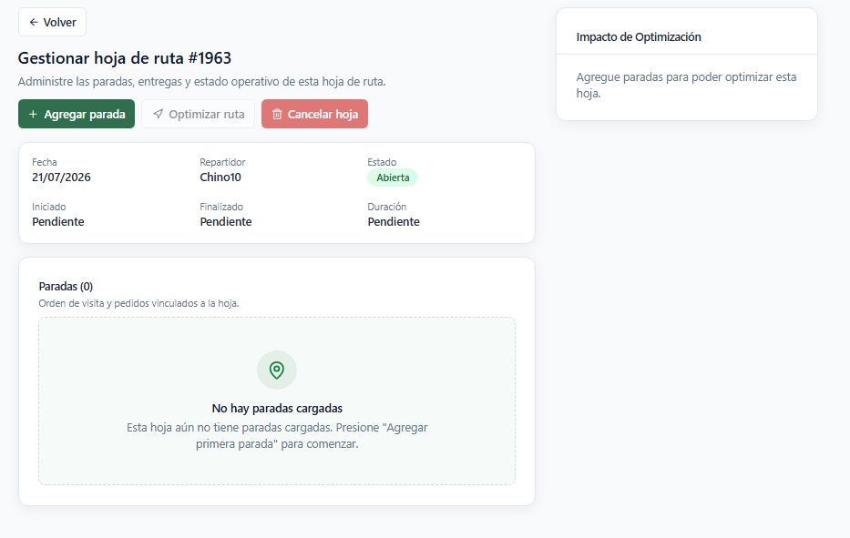
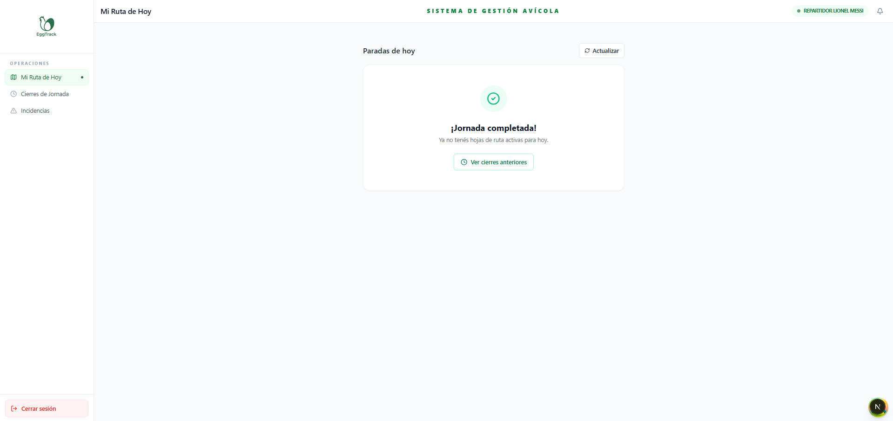
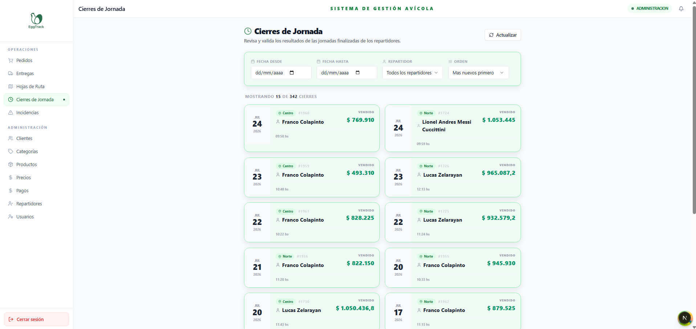
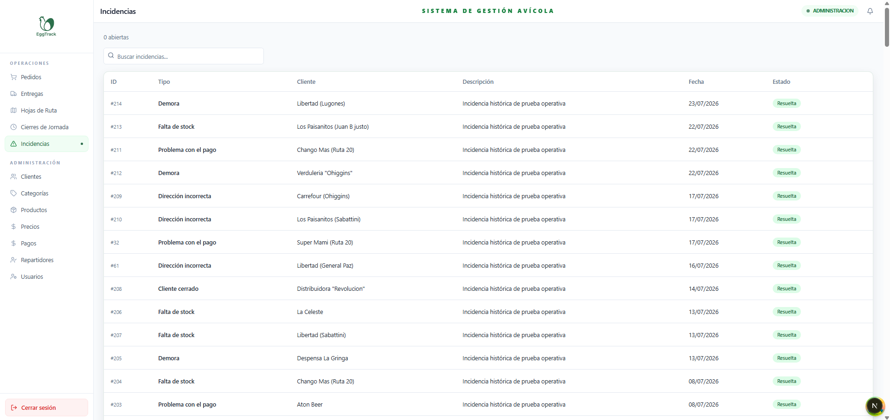
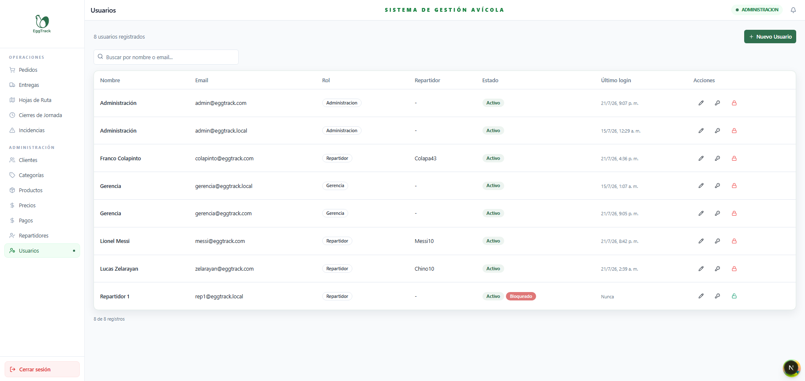
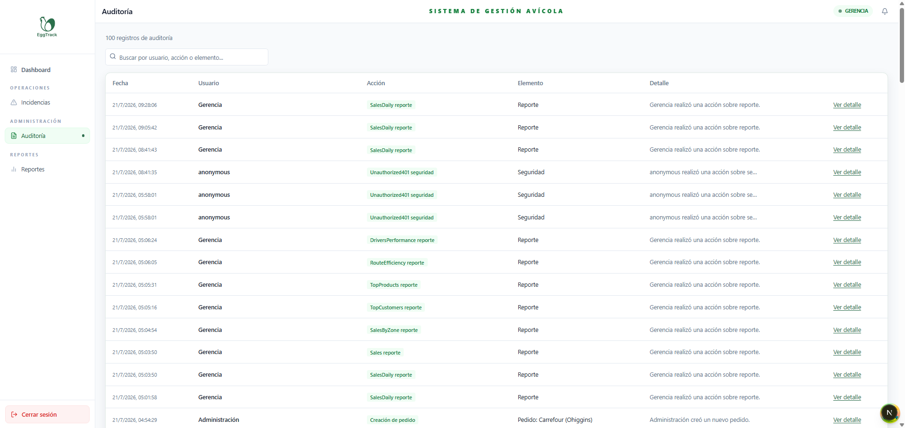
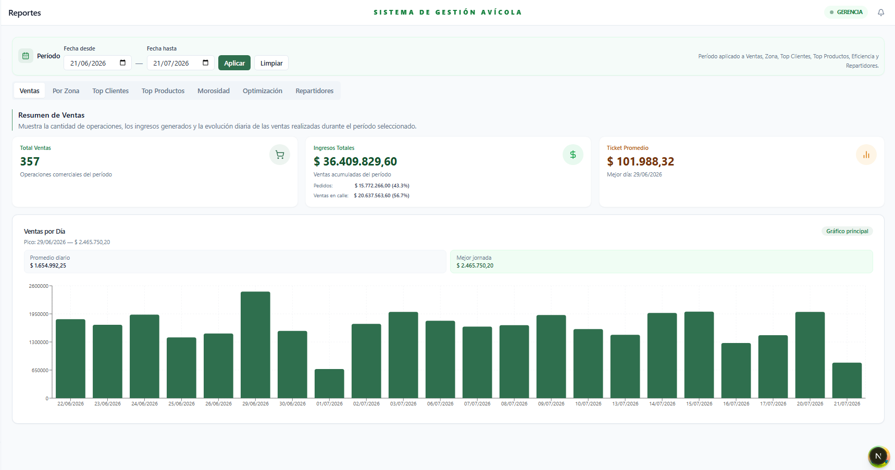

<div align="center">

# 🥚 EggTrack

### Sistema de gestión comercial y logística para distribución avícola

Plataforma web para digitalizar el circuito completo de ventas, reparto y cobranzas de una empresa avícola, reemplazando planillas manuales por un sistema centralizado con trazabilidad, control de rutas y reportes gerenciales en tiempo real.

[](https://nextjs.org/)
[](https://react.dev/)
[](https://www.typescriptlang.org/)
[](https://dotnet.microsoft.com/)
[](https://www.microsoft.com/sql-server)
[]()

**[▶ Probar la demo](https://marcosbarberis.github.io/eggtrack-portfolio/)** · [Ver capturas](#-capturas-de-pantalla)

</div>

---

## 📋 Índice

- [Sobre el proyecto](#-sobre-el-proyecto)
- [Demo en vivo](#-demo-en-vivo)
- [Capturas de pantalla](#-capturas-de-pantalla)
- [Funcionalidades principales](#-funcionalidades-principales)
- [Roles del sistema](#-roles-del-sistema)
- [Arquitectura](#-arquitectura)
- [Stack tecnológico](#-stack-tecnológico)
- [Estructura del proyecto](#-estructura-del-proyecto)
- [Instalación y ejecución local](#-instalación-y-ejecución-local)
- [Equipo](#-equipo)
- [Contexto académico](#-contexto-académico)

---

## 📖 Sobre el proyecto

**EggTrack** fue desarrollado como Práctica Profesionalizante para la carrera *Analista Universitario de Sistemas Informáticos* (Escuela Superior de Comercio Manuel Belgrano – UNC), en conjunto con **Los Martínez S.R.L.**, una empresa familiar cordobesa dedicada a la producción y distribución de huevos.

Antes de EggTrack, el registro de ventas, cobros y saldos se realizaba de forma manual, generando errores, pérdida de información y falta de trazabilidad en el día a día del reparto. El sistema centraliza esa operación: desde la creación de pedidos y hojas de ruta, hasta la ejecución del recorrido por parte del repartidor, el cierre de caja y la validación administrativa, con reportes e indicadores para la dirección.

## ▶️ Demo en vivo

**[marcosbarberis.github.io/eggtrack-portfolio](https://marcosbarberis.github.io/eggtrack-portfolio/)**

La demo es el frontend real de la versión final del sistema corriendo 100 % en el navegador: las llamadas a la API se resuelven con una API simulada que replica las respuestas y reglas de negocio del backend .NET (precios vigentes, descuentos por categoría, límite de crédito, límite diario de efectivo por repartidor, entregas parciales, ventas en la calle, cierre de jornada en dos etapas, auditoría y reportes) sobre **datos ficticios**. No hay datos reales de la empresa ni conexión a servicios externos.

En la pantalla de ingreso podés entrar con un clic con cualquiera de los tres roles (contraseña `demo1234`):

| Rol | Usuario | Qué podés probar |
|---|---|---|
| **Gerencia** | `gerencia@eggtrack.demo` | Dashboard, reportes (ventas, zonas, clientes, productos, morosidad, optimización y repartidores), incidencias y auditoría. |
| **Administración** | `admin@eggtrack.demo` | Pedidos, hojas de ruta con optimización automática, validación de cierres de jornada, clientes y cuenta corriente, precios, pagos, repartidores y usuarios. |
| **Repartidor** | `juan.perez@eggtrack.demo` | Ruta del día en orden optimizado, ventas con cobro contado / parcial / a cuenta, venta en la calle, incidencias y cierre del recorrido. |

Los cambios que hagas se guardan sólo en tu navegador y se pueden borrar con **Reiniciar datos**.

## 📸 Capturas de pantalla

<div align="center">

| Dashboard gerencial | Clientes |
|---|---|
|  |  |

| Pedidos | Hoja de ruta |
|---|---|
|  |  |

| Ruta del repartidor | Cierres de jornada |
|---|---|
|  |  |

| Incidencias | Usuarios |
|---|---|
|  |  |

| Auditoría | Reportes de ventas |
|---|---|
|  |  |

</div>

## ✨ Funcionalidades principales

- **Gestión comercial:** clientes, categorías con descuento y límite de crédito, catálogo de productos y precios vigentes.
- **Pedidos y entregas:** creación y confirmación de pedidos, registro de entregas totales o parciales, ventas en la calle durante el reparto.
- **Logística de rutas:** hojas de ruta diarias con asignación de repartidor, agregado de paradas y optimización automática del orden mediante Google Maps.
- **Cobranzas y cuenta corriente:** registro de pagos, movimientos de cuenta corriente por cliente.
- **Cierres operativos en dos etapas:** el repartidor cierra su hoja al finalizar el recorrido (`PendingManagerValidation`) y Administración la valida (`Closed`).
- **Incidencias:** registro de novedades durante la ejecución de la ruta.
- **Auditoría:** trazabilidad de operaciones críticas (ventas, cobros, cambios de precios) mediante `AuditLog`.
- **Reportes gerenciales:** ventas, distribución por zona, clientes, productos, deuda, aging, desempeño de repartidores y eficiencia de optimización, presentados en indicadores, tablas y gráficos.
- **Notificaciones:** envío de comprobante de compra por correo electrónico al cliente.
- **Seguridad:** autenticación JWT, autorización por roles y políticas, rate limiting en login y operaciones críticas.

## 👥 Roles del sistema

| Rol | Alcance |
|---|---|
| **Gerencia** | Acceso completo: incluye todas las funciones de Administración, más Dashboard, Auditoría y Reportes de forma exclusiva. |
| **Administración** | Gestión de maestros comerciales, usuarios, pedidos, entregas, pagos, rutas e incidencias; valida los cierres de hoja de ruta. |
| **Repartidor** | Consulta y ejecuta exclusivamente las rutas asignadas a su identidad: paradas, entregas, ventas en calle, cobros, incidencias y cierre del recorrido. |

## 🏗️ Arquitectura

EggTrack es una aplicación **web cliente-servidor**:

```
┌─────────────────────────┐        ┌──────────────────────────┐        ┌─────────────────┐
│   Frontend (Next.js)     │  HTTP  │   API REST (ASP.NET Core) │  EF Core │   SQL Server     │
│   React 19 + TypeScript  │ ─────► │   .NET 8                  │ ───────► │   Persistencia   │
│   TanStack Query + Axios │ ◄───── │   JWT + Roles/Políticas   │ ◄─────── │   16 entidades   │
└─────────────────────────┘        └──────────────────────────┘        └─────────────────┘
                                              │
                                              ├── Google Maps Directions & Geocoding API
                                              └── SMTP (comprobantes por correo)
```

El sistema **requiere conexión permanente a la API** para operar; no implementa modo offline ni sincronización diferida.

## 🛠️ Stack tecnológico

**Frontend**
- Next.js 16 (App Router) · React 19 · TypeScript
- Tailwind CSS · Radix UI / componentes propios estilo shadcn
- TanStack Query (estado de servidor y caché) · Axios (cliente HTTP)
- React Hook Form + Zod (formularios y validación)
- Recharts (gráficos de dashboard y reportes)

**Backend**
- ASP.NET Core Web API sobre .NET 8
- Entity Framework Core 8 + SQL Server
- Autenticación JWT · Autorización por roles y políticas · Rate limiting

**Integraciones**
- Google Maps Directions API y Geocoding API (optimización de rutas)
- SMTP para envío de comprobantes por correo electrónico

## 📁 Estructura del proyecto

```
eggtrack/
├── EggTrack.Api/            # Controladores REST, middlewares, Program.cs
├── EggTrack.Application/    # Servicios de aplicación
├── EggTrack.Persistence/    # EF Core, migraciones, DbContext
├── eggtrack.FrontEnd/       # Next.js App Router, componentes, hooks
└── docs/
    └── screenshots/         # Capturas para este README
```

## 🚀 Instalación y ejecución local

**Requisitos previos:** .NET 8 SDK, Node.js, SQL Server (o SQL Server Express).

```bash
# Backend
cd EggTrack.Api
dotnet restore
dotnet run          # aplica migraciones automáticamente al iniciar

# Frontend
cd eggtrack.FrontEnd
npm install
npm run dev
```

Configurá las variables de entorno necesarias (cadena de conexión a SQL Server, claves de Google Maps API, credenciales SMTP y secreto JWT) antes de iniciar el backend.

## 👨‍💻 Equipo

Desarrollado por estudiantes de la Escuela Superior de Comercio Manuel Belgrano (UNC), Comisión 3°A – 2025:

- **Barberis Valle, Marcos David**
- **García, María Agustina**
- **Veliz, Carlos Emanuel**

Docente a cargo: **Lic. Villagra, Fernando Javier**

> 📌 Este repositorio es una copia del portfolio original publicado por Carlos Emanuel Veliz en [emaspvs9-art/eggtrack-portfolio](https://github.com/emaspvs9-art/eggtrack-portfolio). Se mantiene en esta cuenta como parte de mi portfolio personal, ya que participé en el desarrollo del trabajo final junto con el resto del equipo.

## 🎓 Contexto académico

Proyecto final de la Práctica Profesionalizante de la carrera *Analista Universitario de Sistemas Informáticos*, desarrollado con la empresa **Los Martínez S.R.L.** siguiendo la metodología en cascada (estudio preliminar, planificación, relevamiento, diagnóstico y diseño).

---

<div align="center">

Hecho con 🥚 y mucho café en Córdoba, Argentina.

</div>
